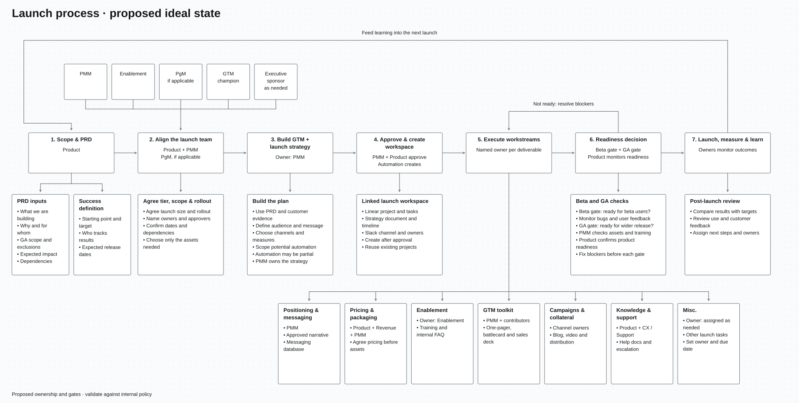

# Launch process: proposed ideal state

[Vector diagram (SVG)](launch-ideal-state.svg) · [HQ PNG, 6720 × 3400](launch-ideal-state.png)

## 1. Scope and PRD

Owner: Product

- Explain what we are building, why, and for whom.
- List what will and will not be ready for general availability (GA).
- Describe the expected impact and any dependencies.
- Set a starting point, target, and owner for tracking results.
- Add expected release dates.

## 2. Align the launch team

Owners: Product and PMM

- Include PMM, Enablement, and a GTM champion.
- Include a program manager (PgM), if applicable.
- Include an executive sponsor when needed.
- Agree on launch size, scope, and rollout.
- Name owners and approvers.
- Confirm dates and dependencies.
- Choose only the assets this launch needs.

## 3. Build GTM + launch strategy

Owner: PMM

- Use the PRD, customer evidence, and existing messaging.
- Define the audience, message, goals, and pricing assumptions.
- Choose channels, rollout steps, and ways to measure success.
- Flag unanswered questions.
- Scope which parts could potentially be automated.
- Automation may be partial. PMM owns the strategy and checks any automated drafts.

## 4. Approve and create the launch workspace

Owners: PMM and Product

- PMM approves the GTM strategy. Product checks product details.
- After approval, create or link the Linear project and tasks.
- Link the strategy document, timeline, and Slack channel.
- Add owners, due dates, and dependencies.
- Reuse existing projects to avoid duplicates.
- Automate setup where practical.

## 5. Execute workstreams

Give each deliverable a named owner. Scale the work to the launch size.

- **Positioning and messaging — PMM:** approved story and messaging database.
- **Pricing and packaging — Product, Revenue, and PMM:** agree pricing before creating assets that use it.
- **Enablement — Enablement:** training and internal FAQ.
- **GTM toolkit — PMM and contributors:** one-pager, battlecard, and sales deck, as needed.
- **Campaigns and collateral — channel owners:** campaigns, blog, video, and distribution, as needed.
- **Knowledge and support — Product and CX/Support:** help documents and an escalation plan.
- **Misc. — owner assigned as needed:** other launch tasks, each with an owner and due date.

Approve the message before finalizing assets. Confirm pricing before publishing commercial claims.

## 6. Readiness decision: Beta and GA gates

Owners: Product for product readiness; PMM for GTM readiness

- **Beta gate:** confirm the product is ready for the planned beta users.
- Monitor bugs, product behavior, and user feedback during beta.
- **GA gate:** confirm the product is ready for wider release.
- Product monitors readiness and confirms whether the product can move through each gate.
- PMM checks that the required assets, training, and launch communications are ready.
- Confirm tracking, support coverage, and a rollback plan where needed.
- Fix blockers or change the scope or date before moving forward.
- Continue monitoring product health after release.

## 7. Launch, measure, and learn

Owners: assigned launch and measurement owners

- Compare results with the starting point and targets.
- Review adoption and customer feedback.
- Assign next steps and owners.
- Use what we learn to improve the next launch.

## Design and validation

- This is a proposed process based on Matilda's diagram and requested changes.
- Confirm internal approval rules and Beta/GA criteria before adopting it as policy.
- The SVG uses Arial, with Helvetica and sans-serif fallbacks.
- Supporting cards use bullet points. Sticky-note guidance is included in the relevant steps.
- Card groups use fixed positions and centered connectors.
- The SVG stays sharp when zoomed. The PNG is exported at 6720 × 3400 pixels.
- These files are not a native FigJam board.
