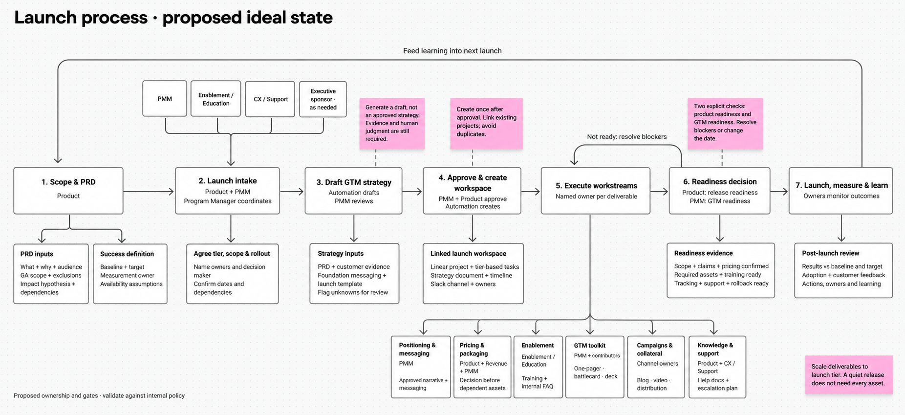

# Launch process: proposed ideal state

Status: proposed process based on Matilda's launch-process diagram. Ownership and gates require validation against current internal policy.

## Workflow

| Step | Owner | Required output |
| --- | --- | --- |
| 1. Scope and PRD | Product | What and why, target audience, GA scope and exclusions, impact hypothesis, dependencies and availability assumptions. Define a baseline, target and measurement owner. |
| 2. Launch intake | Product + PMM; Program Manager coordinates | Agree launch tier, scope and rollout. Name deliverable owners and decision maker. Confirm dates and dependencies. Involve Enablement/Education, CX/Support and an executive sponsor where needed. |
| 3. Draft GTM strategy | Automation drafts; PMM reviews | Combine PRD, customer evidence, foundation messaging and launch templates. Cover audience, positioning, goals, pricing assumptions, rollout, channels and measurement. Flag unknowns for review. |
| 4. Approve and create workspace | PMM approves GTM strategy; Product validates product accuracy | After approval, automation creates or links the Linear project, tier-based tasks, strategy document, timeline and Slack channel. Include owners and dependencies; avoid duplicate projects. |
| 5. Execute workstreams | Named owner per deliverable | Produce the tier-appropriate deliverables listed below. |
| 6. Readiness decision | Product: release readiness; PMM: GTM readiness | Confirm scope, claims and pricing; required assets and training; tracking, support and rollback readiness. Resolve blockers or update scope/date before launch. |
| 7. Launch, measure and learn | Assigned launch and measurement owners | Monitor outcomes, compare results with baseline and target, capture adoption and customer feedback, and assign follow-up actions. Feed learning into the next launch. |

## Parallel workstreams

| Workstream | Proposed owner | Deliverables |
| --- | --- | --- |
| Positioning and messaging | PMM | Positioning options, approved narrative and messaging database |
| Pricing and packaging | Product + Revenue + PMM | Approved commercial decisions before dependent assets |
| Enablement | Enablement/Education | Training and internal FAQ |
| GTM toolkit | PMM + contributors | One-pager, battlecard and sales deck, according to launch tier |
| Campaigns and collateral | Channel owners | Campaign plan, distribution, blog and video where relevant |
| Knowledge and support | Product + CX/Support | Knowledge document, help documentation and escalation plan |

Workstreams can overlap, but approve positioning before finalizing collateral and settle pricing before publishing commercial claims.

## Automation boundaries

- Generate a strategy draft, not an approved strategy. The PRD does not settle positioning, pricing, channels or launch targets by itself.
- Create the launch workspace after strategy approval. Link existing projects rather than creating duplicates.
- Scale tasks and assets to launch tier. A quiet release does not need every deliverable.
- Route changes to PRD scope, pricing or availability to affected owners for review of messaging, assets and dates.
- External publishing remains a separate approval step.

## Critique and validation

The original diagram established useful PRD inputs and GTM workstreams. This revision adds the missing tier decision, measurable success criteria, early CX/Support involvement, explicit approval and readiness gates, a blocker-resolution loop and post-launch learning.

The proposal was reviewed for ownership, inputs, outputs, dependencies and failure paths. It has not been validated against live internal policy or tested through an actual launch. Confirm approval authority, rollout gates and timing before adopting it as company policy.

The accompanying PNG resembles the original FigJam design; it is an image mockup, not an editable FigJam board. This document is the editable process description.
