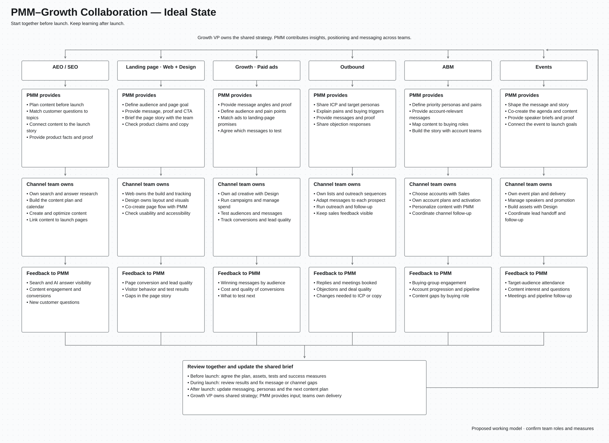

# PMM–Growth Collaboration — Ideal State

[Vector diagram (SVG)](pmm-growth-collaboration-ideal-state.svg) · [HQ PNG, 5600 × 4080](pmm-growth-collaboration-ideal-state.png)

## How it works

- Start planning together before launch.
- The Growth VP owns the shared Growth strategy and priorities.
- PMM feeds customer insights, ICP and persona input, positioning, messaging, and launch context into the work.
- Each Growth team helps shape the plan and owns delivery in its channel.
- Teams adapt the message to their channel while keeping product claims accurate.
- Share results with PMM so the story, content, and targeting improve over time.
- Use this model for launches and ongoing growth work.

## One shared brief

The Growth VP sets the shared direction. PMM contributes product and customer context to a brief built with the teams. Update it together as new evidence comes in.

- **Audience:** ideal customer profile (ICP), personas, pains, and buying triggers.
- **Story:** customer problem, product value, key messages, and proof.
- **Goal:** the action we want people to take and how we will measure it.
- **Plan:** launch dates, owners, required assets, dependencies, and open questions.
- **Boundaries:** what the product can do, what is not ready, and which claims are approved.

## AEO / SEO: plan content ahead of launch

Answer engine optimization (AEO) helps content appear in AI-generated answers. Search engine optimization (SEO) helps people find it through search.

**PMM provides**

- Audience needs, pain points, and the launch story.
- Product facts, proof, comparisons, and answers to common questions.
- Content priorities tied to the product and launch goals.

**AEO/SEO owns**

- Search and AI-answer research, including topics and customer questions.
- The content plan, calendar, and search requirements.
- Content creation and optimization, with writers and subject experts.
- Links between educational content, product content, and landing pages.

**Plan together before launch**

- Map customer questions to content and identify missing pages.
- Agree what to create, update, or combine.
- Start educational content early where useful. Align product announcements with release readiness.
- Treat search rankings and AI visibility as outcomes to measure over time, not guaranteed launch-day results.

**Feedback to PMM**

- Search and AI-answer visibility.
- Engagement and conversions from content.
- New questions, competitive gaps, and topics worth covering next.

## Landing page: Web + Design

**PMM provides**

- The audience, page goal, core message, proof, and call to action.
- The product story and checks on product claims.
- A clear brief, with feedback from the channel teams sending traffic to the page.

**Web + Design own**

- Web: page build, tracking, performance, and technical checks.
- Design: layout, visuals, and a clear reading experience.
- Page flow and copy are developed with PMM and the relevant content owner.
- Usability, accessibility, and page testing.

**Feedback to PMM**

- Conversion rates and lead quality.
- Visitor behavior and test results.
- Questions or gaps in the page story.

## Growth: paid ads and message testing

**PMM provides**

- Message angles, customer pains, proof, and target audiences.
- Product claims and a clear connection between the ad and landing page.
- A shortlist of messages to test with Growth.

**Growth owns**

- Campaign setup, budgets, audiences, and testing.
- Ad copy and creative, working with PMM and Design.
- Channel performance, conversion tracking, and optimization.

**Feedback to PMM**

- Which messages work for which audiences.
- Conversion cost and lead quality, alongside clicks.
- What to keep, change, or test next.

## Outbound: messaging, ICP, and persona pain points

**PMM provides**

- ICP, target personas, pain points, and buying triggers.
- Relevant messages, proof, and responses to common objections.
- Guidance on which use cases matter to each persona.

**Outbound owns**

- Prospect lists, outreach sequences, and follow-up.
- Adapting the message to each prospect.
- Testing outreach and sharing what prospects say.

**Feedback to PMM**

- Replies, meetings, and the quality of opportunities.
- Common objections and reasons people do not respond.
- Evidence that the ICP, persona, or message needs to change.

## ABM: messaging, personas, and content

Account-based marketing (ABM) focuses coordinated marketing and sales work on selected accounts.

**PMM provides**

- Messages and proof for the account's needs.
- Persona pains and content for each buying role.
- A shared story developed with ABM and account teams.

**ABM owns**

- Choosing accounts with Sales.
- Account plans and coordinated campaigns.
- Personalizing content with PMM and relevant content owners.
- Coordinating channels and sales follow-up.

**Feedback to PMM**

- Engagement across the buying group.
- Account progress and pipeline.
- Missing content or objections by buying role.

## Events: messaging, content, narrative, and agenda

**PMM provides**

- The event story and its connection to product and launch goals.
- Messaging, product proof, speaker briefs, and content ideas.
- An agenda developed with Events around audience needs.

**Events owns**

- Event format, planning, logistics, and delivery.
- Speaker coordination, promotion, and assets with Design.
- Lead handoff and follow-up with Sales and Growth.

**Feedback to PMM**

- Attendance from the target audience.
- Content engagement and questions people ask.
- Meetings, follow-up results, and pipeline where tracked.

## Review and improve together

- **Before launch:** agree on the brief, content plan, landing page, channel tests, owners, and success measures.
- **During launch:** review results, monitor product changes, and fix message or channel gaps.
- **After launch:** compare results with goals and update messaging, personas, and the next content plan.
- Review channel results with the Growth VP. Use the findings to inform Growth priorities and PMM inputs.
- Keep one current brief and link to channel plans rather than copying them into separate versions.
- Agree a review schedule that fits the size of the work.

## Status and design

- Proposed working model based on Matilda's requested collaboration areas.
- Confirm the exact team roles, copy ownership, and measures internally.
- Includes all six requested teams, pre-launch planning, delivery ownership, and feedback to PMM.
- Uses simple wording, bullet points, Arial with font fallbacks, and no sticky notes.
- The SVG uses evenly spaced columns and stays sharp when zoomed.
- The PNG is exported at 5600 × 4080 pixels.
